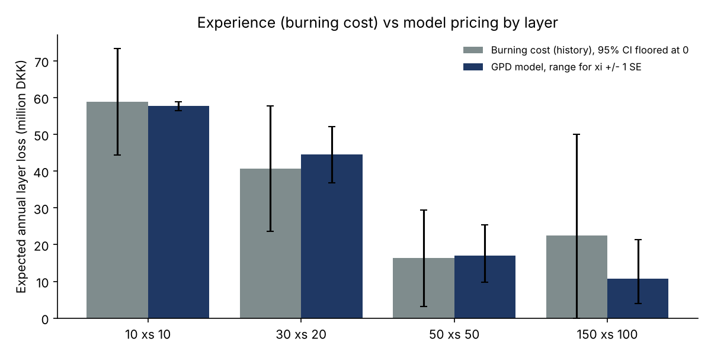
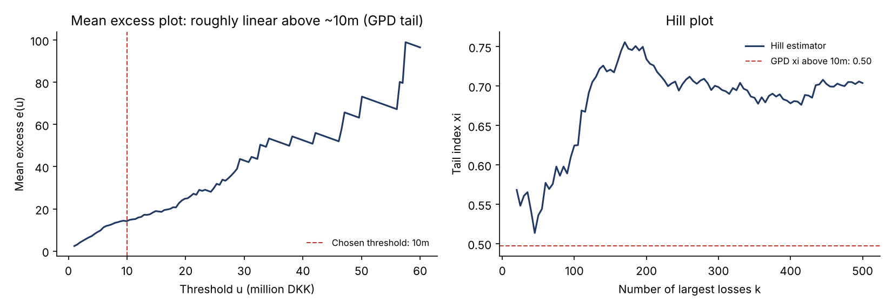
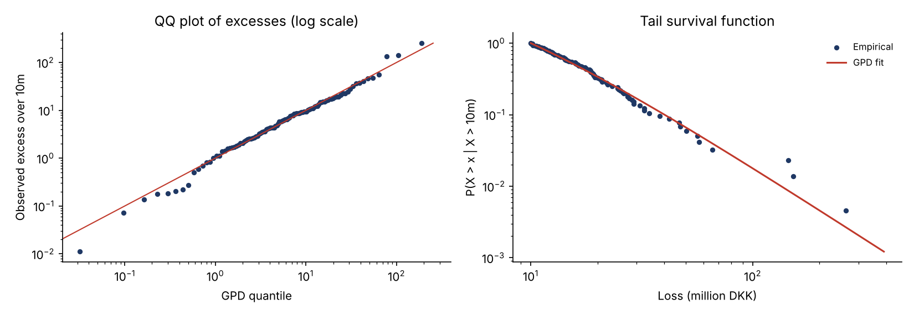
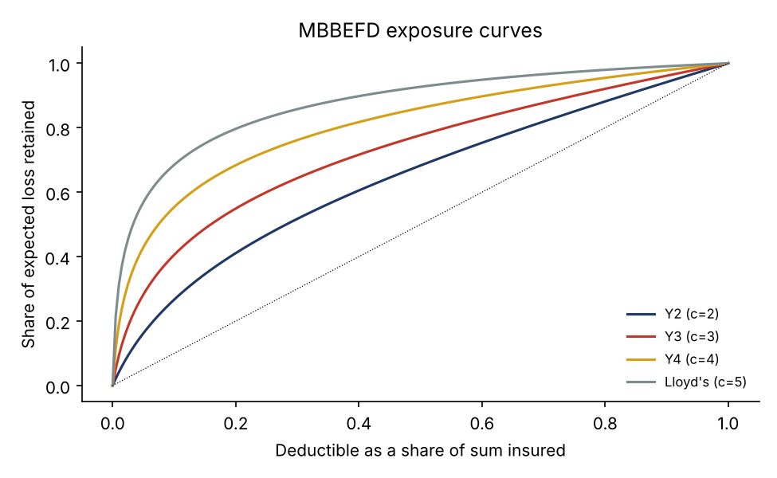

# Per-Risk Excess-of-Loss Reinsurance Pricing with Extreme Value Theory

A from-scratch Python pricing engine for property per-risk excess-of-loss (XL) treaties, applied to the classic Danish fire large-loss data (2,167 losses above DKK 1m, 1980-1990, inflation-adjusted to 1985):

1. **Severity**: extreme value theory, with a Generalized Pareto (GPD) tail above DKK 10m, threshold selection, a Hill estimator and goodness-of-fit diagnostics.
2. **Frequency**: annual counts of large losses, Poisson versus negative binomial.
3. **Layer pricing**: experience rating (burning cost) versus model rating, with a closed-form expected layer loss and a one-million-year Monte Carlo collective risk model.
4. **Treaty structure**: paid reinstatements, technical premium with a cost-of-capital loading, rate on line and payback period.
5. **Exposure rating**: MBBEFD exposure curves (Swiss Re Y2-Y4, Lloyd's) on an illustrative risk profile.

All amounts are in DKK million.

## Key results

| Layer | Burning cost | GPD model | Model range (xi +/- 1 SE) | Losses in history | P(any loss) | Technical premium | Rate on line |
|---|---|---|---|---|---|---|---|
| 10 xs 10 | 58.9 | 57.7 | 56.5 - 58.8 | 109 | 100% | 71.2 | 712% |
| 30 xs 20 | 40.7 | 44.6 | 36.8 - 52.1 | 36 | 97% | 60.9 | 203% |
| 50 xs 50 | 16.3 | 17.0 | 9.8 - 25.3 | 7 | 48% | 29.8 | 60% |
| 150 xs 100 | 22.5 | 10.8 | 3.9 - 21.4 | 3 | 16% | 28.1 | 19% |



**What the table says:**

- **Low layers: experience and model agree.** 10 xs 10 is hit about ten times a year, so the burning cost is reliable and the model only confirms it. With an expected loss of almost six times the limit, it is a working layer: the cedant would normally retain it, or buy it with an aggregate cap.
- **High layers: the burning cost cannot be trusted.** 150 xs 100 was hit by only 3 losses in 11 years, one of them DKK 263m. The burning cost (22.5) is twice the model (10.8) because the historical period happened to contain an extreme loss. Pricing it needs a tail model.
- **Parameter risk explodes in the tail.** A one-standard-error change in the tail index xi moves the expected loss of 150 xs 100 by a factor of 5 (3.9 to 21.4), against only 4% for 10 xs 10. The tail index is the key pricing assumption for high layers.

## Validation

| Quantity | This project | scipy | Published (McNeil, 1997) |
|---|---|---|---|
| Exceedances over DKK 10m | 109 | n/a | 109 |
| Tail index xi | 0.497 | 0.497 | 0.497 |
| Scale beta | 6.98 | 6.98 | 6.98 |

- **GPD fit:** the maximum likelihood fit reproduces the published estimates of McNeil (1997, *ASTIN Bulletin*) and agrees with scipy to five decimals.
- **Closed form vs simulation:** for every layer, the closed-form expected loss and the one-million-year simulation agree within 0.6 Monte Carlo standard errors. At 200,000 simulated years, the top layer showed a gap of 2.8 standard errors. Tests on five other seeds gave gaps between 0.0 and 2.1, which identified it as simulation noise in a very heavy-tailed layer, so the simulation was increased to one million years.
- **Reinstatement pricing:** for every structure, expected premium plus expected reinstatement premiums equals expected recoveries exactly.
- **Exposure curves:** the parameterisation b(c), g(c) and the curve G(x) follow Bernegger (1997), as implemented in the CRAN package `MBBEFDLite`. Beyond G(0) = 0 and G(1) = 1 (which any parameters satisfy), two non-trivial properties are checked for c = 1.5 to 5: the slope at the origin equals the inverse of the mean loss degree, 1/G'(0) = ln(gb)(1-b)/(ln(b)(1-gb)), and G'(1)/G'(0) equals the total-loss probability 1/g. Both hold to six decimals.

## Severity: extreme value theory





- **Threshold.** The mean excess function rises roughly linearly, the signature of a Pareto-type tail. The threshold of DKK 10m leaves 109 exceedances.
- **Tail index.** xi = 0.50 (SE 0.14) means the tail is so heavy that the variance of the losses is barely finite. A likelihood ratio test rejects an exponential tail (xi = 0, statistic 44.8, p < 0.0001).
- **Hill estimator.** The Hill estimator is unstable and sits higher, around 0.55 to 0.75. This is a reminder that the tail index is uncertain, and is why the pricing shows the xi +/- 1 SE range.

## Frequency

Large losses average 9.9 a year, with a variance of 8.3. With no over-dispersion, a Poisson process is retained rather than a negative binomial. Counts trend upward over the decade, from 166 losses in 1980 to 238 in 1986, so on a real treaty the frequency would be adjusted to the portfolio's current size.

## Treaty structure: reinstatements on 30 xs 20

| Structure | Upfront premium | Expected reinstatement premium | Expected recoveries |
|---|---|---|---|
| No reinstatement | 24.3 | 0.0 | 24.3 |
| 1 reinstatement at 100% | 20.8 | 16.9 | 37.7 |
| 2 reinstatements at 100% | 19.0 | 23.8 | 42.7 |
| 2 reinstatements at 50% | 26.3 | 16.5 | 42.7 |
| Unlimited free reinstatements (expected loss) | 44.6 | n/a | 44.6 |

Paid reinstatements cut the upfront premium sharply: the cedant pays only when the cover is used. The pure premium P solves:

```math
P \left(1 + c \, \frac{E[\min(L, k\,l)]}{l}\right) = E[\min(L, (k+1)\,l)]
```

with k reinstatements, a reinstatement rate c, layer limit l and annual layer loss L.

## Technical premium

```math
\text{Premium} = \frac{E[L] + \text{CoC} \times (\text{VaR}_{99.5\%}(L) - E[L])}{1 - \text{expenses}}
```

The calculation uses a 10% cost of capital and 10% for brokerage and expenses. The rate on line is the premium divided by the limit, and the payback period is its inverse. The 50 xs 50 layer, for example, pays back in 1.7 years.

## Exposure rating (illustrative)



| Curve | Expected loss, 30 xs 20 | Total loss probability |
|---|---|---|
| Swiss Re Y2 (c = 2) | 6.97 | 13.0% |
| Swiss Re Y3 (c = 3) | 5.35 | 3.3% |
| Swiss Re Y4 (c = 4) | 3.77 | 0.6% |
| Lloyd's industrial (c = 5) | 2.44 | 0.1% |

Exposure rating prices a layer from the cedant's risk profile (sums insured and premiums) instead of its loss history, and is essential when history is thin. Here it runs on an **illustrative** profile, not on the Danish portfolio, so these figures should not be compared with the experience results. The choice of curve alone changes the expected loss by a factor of almost three.

## Repository structure

```
├── run_study.py           # full pricing study: fits, layers, reinstatements, exposure rating, charts
├── data/
│   └── danish_fire_losses.csv
├── src/
│   ├── severity.py        # mean excess, GPD maximum likelihood, Hill, layer expected values
│   ├── pricing.py         # frequency, burning cost, simulation, reinstatements, loadings
│   └── exposure_rating.py # MBBEFD exposure curves and exposure rating
└── results/
    ├── figures/
    ├── tables/
    └── run_log.txt
```

## How to run

```bash
pip install -r requirements.txt
python run_study.py
```

## Limitations and next steps

- **As-if adjustments:** the losses are already inflation-adjusted, but a real treaty also needs development of open claims and adjustment to current exposure.
- **Blending:** credibility weighting of experience and exposure rating on the same portfolio.
- **Contract features:** an annual aggregate deductible, a stability clause, and catastrophe XL with event definitions and hours clauses.
- **Threshold sensitivity:** refit the GPD over a range of thresholds and use Bayesian estimation of xi to carry parameter uncertainty into the price.

## References

- McNeil, A. (1997). Estimating the tails of loss severity distributions using extreme value theory. *ASTIN Bulletin*.
- Bernegger, S. (1997). The Swiss Re exposure curves and the MBBEFD distribution class. *ASTIN Bulletin*.
- Embrechts, P., Klüppelberg, C. and Mikosch, T. (1997). *Modelling Extremal Events for Insurance and Finance*. Springer.

Data: Danish fire insurance losses (Copenhagen Re), as distributed in the `fitdistrplus` R package.

---

**Author:** Yassine El Bakali, MSc in Actuarial Science (ULB) · yelbakali@yahoo.be
